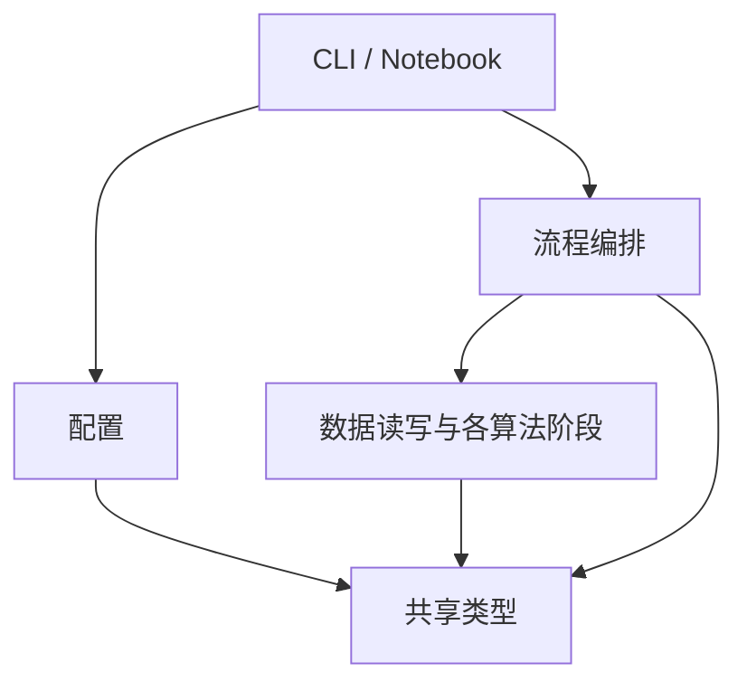

# V0 Python 代码架构

`src/` 已建立，包含实验 Notebook 和 `stereo_vision` 包。离线 Middlebury 最简链路已实现，其余模块仍按下文职责逐步落地。算法、数据单位与验收指标以 [算法规格](doc/algorithm/algorithm.md) 为准，开发顺序见 [V0 执行计划](doc/exe_plans/active/V0_stereo_pipeline.md)。

## 模块职责

使用 `src/stereo_vision/` 作为 Python 包。Notebook 负责选择场景、调用函数与展示结果，CLI 和 Notebook 共用包内接口。

| 模块 | 职责 |
|---|---|
| `models.py` | 声明共享的数据类和数组类型，区分原始图像对、校正图像对、校正几何及重建结果 |
| `config.py` | 读取并校验 `config/` 下的运行配置，返回有类型的参数 |
| `datasets.py` | 读取双目图、标定文件、真值和掩码，检查场景、尺寸和格式，把数据集约定转成内部类型 |
| `capture.py` | 从相机采集并保存左右图与配对信息 |
| `calibration.py` | 检测棋盘格角点，计算内参、畸变和双目外参 |
| `rectification.py` | 构建校正映射和重投影矩阵，对原始图像对应用校正 |
| `disparity.py` | 用 SGBM 计算像素单位视差，返回匹配有效性信息 |
| `reprojection.py` | 根据视差和校正几何计算深度、三维坐标及重建有效掩码 |
| `evaluation.py` | 根据预测、真值和掩码计算误差与覆盖率 |
| `outputs.py` | 保存数组、掩码、预览图、RGB 点云及指标 |
| `pipeline.py` | 组合已有模块，按输入类型选择原始图像或已校正图像的重建流程 |
| `cli.py` | 解析命令行参数、校验配置、调用流程并报告失败 |

先实现离线读图所需的模块，其余模块随对应任务落地。函数实现集中在包内，Notebook 中保留实验参数选择、调用与展示。

## 导入方向

箭头表示左侧可以导入右侧。库依赖如标准库、NumPy 和 OpenCV 不在图中。

- 同层阶段独立，通过参数和返回值交换数据。需要先校正再匹配时，由 `pipeline.py` 顺序调用。
- 共享类型放在 `models.py`。底层模块不得导入流程入口；`__init__.py` 保持轻量，内部从定义模块显式导入。
- 新增跨模块导入时检查依赖方向。若两个模块需要互相导入，先由调用层编排；确有共用的数据类型时下移到 `models.py`。函数内延迟导入和 `TYPE_CHECKING` 不用于规避层级约束。

## 命名与可读性

| 对象 | 约定 | 示例 |
|---|---|---|
| 模块、函数、变量 | 使用 `snake_case`，模块名表达职责，函数名使用动词 | `rectification.py`、`compute_disparity` |
| 类型、常量 | 数据类用 `PascalCase`，模块常量用 `UPPER_SNAKE_CASE` | `RectifiedPair`、`DISPARITY_SCALE` |
| 左右顺序、颜色和单位 | 名称体现容易混淆的语义 | `left_bgr`、`right_gray`、`disparity_px`、`depth_m` |
| 导入和排版 | 使用四空格缩进，按标准库、第三方库、项目模块分组；避免通配导入 | `from stereo_vision.models import RectifiedPair` |

函数参数、返回值和变量显式标注类型。对外函数的文档字符串说明数组的元素类型、形状、单位和坐标约定，并说明可能抛出的异常。项目内部名称沿用上述风格，调用 OpenCV 时保留其 API 的关键字拼写。

## 数据与错误边界

- 调用层显式传入路径和已校验参数；算法函数接收数据，导入模块时不读文件、不启动相机、不运行实验。
- 原始相机图先校正，再算视差。Middlebury 已校正图像从匹配阶段进入，数据适配层保留主点偏移并统一基线单位。
- 匹配结果使用 `float32 (H, W)`、单位 px；深度使用 `float32 (H, W)`、单位 m，无效值为 `NaN`；有效掩码使用 `bool (H, W)`。预览图在输出层生成。
- 缺失文件抛出 `FileNotFoundError`，非法形状、配置或数据格式抛出 `ValueError`。错误信息应能定位路径、场景或参数。批量实验在入口记录失败，保留样本身份。

第一批实现从读取 `Adirondack` 开始，验证左右图、标定、真值和掩码的形状配套，以及缺文件和尺寸不符时的报错。

## 当前已实现范围

离线入口为 `run_experiment.py` 和 `src/offline_middlebury.ipynb`。两者使用同一个配置读取器、Middlebury 适配器及 `reconstruct_scene`，输入与实验参数来自 `config/middlebury.json`。配置相对路径按配置文件所在目录解析。

- `models.py` 定义 `RunConfig`、`SgbmConfig`、`RectifiedPair`、`RectifiedGeometry`、`GroundTruth`、`StereoScene` 及各阶段结果类型，数组以 `NDArray` 明确元素类型。
- `datasets.py` 负责 PFM、掩码、图像与标定的格式约定，将毫米基线及主点偏移转换为以米为单位的 Q。原始数据集字段不泄漏到匹配和重投影模块。
- `disparity.py` 返回像素视差、匹配有效掩码及固定搜索域；`reprojection.py` 使用 Q 返回深度、三维坐标与重建掩码。
- `pipeline.py` 组合匹配、重投影和可选的真值评价，返回 `PipelineResult`；真值只传给评价函数。输出模块接收结果保存数值、伪彩预览、彩色 PLY、指标与逐样本记录。

采集、真实双目标定和原始图像校正模块随 A1/A2 与硬件路线实现。当前公开入口只接收 `RectifiedPair`；实现原始图像流程时再增加对应类型和校正入口。Notebook 保留参数选择、函数调用和 Matplotlib 展示。具体数据口径与已验证范围见 [离线实现说明](doc/algorithm/offline_middlebury.md)。
