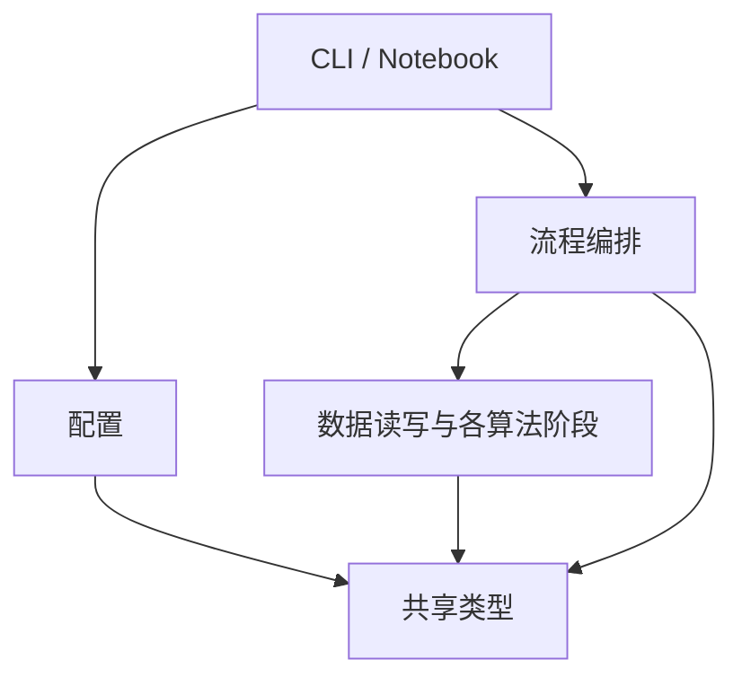

# V0 Python 代码架构

`src/model.py` 已实现共享数据模型，`src/datasets.py` 已实现 Middlebury 离线读取，`src/config.py` 已实现 JSON 配置读取与校验，`src/disparity.py` 已实现 SGBM 匹配，`src/reprojection.py` 已实现米制深度与三维重建，`src/evaluation.py` 已实现离线视差评估，`src/outputs.py` 已实现离线产物导出，`src/pipeline.py` 已串联单场景离线流程，`src/cli.py` 已提供命令行入口。下文定义该模块与后续模块的职责和依赖方向。算法、数据单位与验收指标以 [算法规格](doc/algorithm/algorithm.md) 为准，开发顺序见 [V0 执行计划](doc/exe_plans/active/V0_stereo_pipeline.md)。

## 模块职责

CLI 通过 `pipeline.py` 运行单场景离线重建，Notebook 逐步调用相同模块并展示中间结果。采集、真实相机标定和极线校正模块仍待实现。

| 模块 | 职责 |
|---|---|
| `model.py` | 声明共享的数据类和数组类型，区分原始图像对、校正图像对、校正几何及重建结果 |
| `config.py` | 读取并校验 `config/` 下的运行配置，返回有类型的参数 |
| `datasets.py` | 读取双目图、标定文件、真值和掩码，检查场景、尺寸和格式，把数据集约定转成内部类型 |
| `capture.py` | 从相机采集并保存左右图与配对信息 |
| `calibration.py` | 检测棋盘格角点，计算内参、畸变和双目外参 |
| `rectification.py` | 构建校正映射和重投影矩阵，对原始图像对应用校正 |
| `disparity.py` | 用 SGBM 计算像素单位视差，返回匹配有效性信息 |
| `reprojection.py` | 根据视差和校正几何计算深度、三维坐标及重建有效掩码 |
| `evaluation.py` | 根据预测、真值和掩码计算误差与覆盖率 |
| `outputs.py` | 保存数组、掩码、预览图、RGB 点云及指标 |
| `pipeline.py` | 编排已校正 Middlebury 图像的离线重建、评估与可选导出 |
| `cli.py` | 解析命令行参数、校验配置、调用流程并报告失败 |

其余模块随对应任务落地。函数实现集中在 `src/`，Notebook 中保留实验参数选择、调用与展示。

当前共享模型包括 `RawPair`、`RectifiedPair`、`RectificationGeometry`、`DisparityResult` 和 `ReconstructionResult`。校正几何保留匹配和重建所需的图像尺寸、`Q` 与双侧 ROI。旋转、投影矩阵和重映射表由后续校正模块负责。模型字段带类型和单位约定，调用层负责校验，NumPy 数组按引用传递。

## CLI 指令

先激活 `SVP_env`，再在仓库根目录运行。

| 指令 | 用途 |
|---|---|
| `python -m src.cli --help` | 查看参数 |
| `python -m src.cli` | 使用 `config/offline.json` 执行单场景离线流程，按配置导出 |
| `python -m src.cli --config config/offline.json` | 显式指定配置，也可传入其他 JSON 路径 |
| `python -m src.cli --no-export` | 计算重建和指标，跳过文件导出，可与 `--config` 组合 |
| `python -m src.cli --preview` | 计算完成后打开视差与深度预览窗口，可与 `--no-export` 组合 |

可用 `--split trainingQ|testQ` 和 `--scene 场景名` 选择图像对。例如：

```sh
python -m src.cli --split testQ --scene Australia --no-export
```

数据位于其他位置时，使用 `--image-root 路径` 和 `--ground-truth-root 路径` 覆盖配置中的根目录。训练场景需使用与图像匹配的真值目录。CLI 路径相对于当前工作目录，JSON 内的相对路径仍以配置文件所在目录为准。当前读取器支持 Middlebury Q 版目录结构。

`cli.py` 解析参数后调用 `load_offline_config` 和 `run_offline_pipeline`。成功时向标准输出写 JSON，包含场景、指标和导出目录，未导出时目录为 `null`。成功退出码为 0，运行失败为 1，命令行参数错误为 2。错误写到标准错误。配置内的相对路径以配置文件所在目录为准。预览使用交互式 Matplotlib 后端，关闭窗口后命令结束。窗口无法打开时报告预览失败并返回 1，已生成的重建结果仍可用。

## 导入方向

箭头表示左侧可以导入右侧。库依赖如标准库、NumPy 和 OpenCV 不在图中。



- 同层阶段独立，通过参数和返回值交换数据。需要先校正再匹配时，由 `pipeline.py` 顺序调用。
- 共享类型放在 `model.py`。底层模块不得导入流程入口；`__init__.py` 保持轻量，内部从定义模块显式导入。
- 新增跨模块导入时检查依赖方向。若两个模块需要互相导入，先由调用层编排；确有共用的数据类型时下移到 `model.py`。函数内延迟导入和 `TYPE_CHECKING` 不用于规避层级约束。

## 命名与可读性

| 对象 | 约定 | 示例 |
|---|---|---|
| 模块、函数、变量 | 使用 `snake_case`，模块名表达职责，函数名使用动词 | `rectification.py`、`compute_disparity` |
| 类型、常量 | 数据类用 `PascalCase`，模块常量用 `UPPER_SNAKE_CASE` | `RectifiedPair`、`DISPARITY_SCALE` |
| 左右顺序、颜色和单位 | 名称体现容易混淆的语义 | `left_bgr`、`right_gray`、`disparity_px`、`depth_m` |
| 导入和排版 | 使用四空格缩进，按标准库、第三方库、项目模块分组；避免通配导入 | `from src.model import RectifiedPair` |

函数参数、返回值和变量显式标注类型。对外函数的文档字符串说明数组的元素类型、形状、单位和坐标约定，并说明可能抛出的异常。项目内部名称沿用上述风格，调用 OpenCV 时保留其 API 的关键字拼写。

## 数据与错误边界

- 调用层显式传入路径和已校验参数；算法函数接收数据，导入模块时不读文件、不启动相机、不运行实验。
- 原始相机图先校正，再算视差。Middlebury 已校正图像从匹配阶段进入，数据适配层保留主点偏移并统一基线单位。
- 匹配结果使用 `float32 (H, W)`、单位 px；深度使用 `float32 (H, W)`、单位 m，无效值为 `NaN`；有效掩码使用 `bool (H, W)`。预览图在输出层生成。
- 缺失文件抛出 `FileNotFoundError`，非法形状、配置或数据格式抛出 `ValueError`。错误信息应能定位路径、场景或参数。批量实验在入口记录失败，保留样本身份。

`config.py` 和 `datasets.py` 各自只依赖项目内的 `model.py`。调用层将离线配置中的路径和场景交给数据读取层，将校验后的 `SgbmConfig` 交给后续匹配函数。硬件解析只提取设备身份和运行状态，规格字段仍保留在硬件档案。

Middlebury 适配器从校正后的内参与基线构造 `Q`，使用全图作为校正 ROI。PFM 按 [Middlebury 格式约定](https://vision.middlebury.edu/stereo/submit3/upload-format.html) 解码，比例字段的符号决定字节序，原始浮点值已是像素视差。

`disparity.py` 接收校正图像对、几何和已校验的 `SgbmConfig`。返回的 `DisparityResult` 包含像素视差、有效搜索 ROI 和匹配有效掩码。无效视差用 `NaN`；后续重投影阶段再检查正深度与有限三维坐标。

`reprojection.py` 只依赖项目内的 `model.py`。调用方传入 `DisparityResult`、校正图像对及配套几何。重投影结合匹配有效掩码、有限坐标和正深度生成 `ReconstructionResult`，供后续评估与点云导出使用。

`evaluation.py` 只依赖项目内的 `model.py`，由调用方提供预测、可选参考视差和参考掩码。该模块返回结构化指标，Notebook 负责显示，并将指标映射传给产物层。

`outputs.py` 接收 `ReconstructionResult`、指标映射、实验参数和目标路径。运行目录在所有文件写完后发布；每次调用生成独立目录。

`run_offline_pipeline` 接收已解析的 `OfflineConfig`，返回匹配、重建、指标和可选导出目录。Notebook 仍可分别调用各阶段来检查中间结果。

## 独立研究扩展：置信度与重估计

用户授权的后续研究单列于 [研究计划](doc/exe_plans/active/confidence_extension.md)，不改变 V0 基线入口。`confidence.py` 计算 LRC 与 DPS 一致性评分；`reestimation.py` 仅接收预测、评分和候选并选择替换点；`confidence_experiment.py` 编排既有 SGBM、反向/位移预测、候选生成与冻结实验。阶段模块只依赖 `model.py` 的共享类型。原 `pipeline.py`、匹配、重投影、评价和导出实现保持原状。

研究命令：`python -m src.confidence_experiment --phase develop|evaluate|verify`（选择其中一个 phase）。配置在 `config/confidence_experiment.json`，输出在 `artifacts/confidence_extension/`；实验Notebook为 `notebook/confidence_extension.ipynb`。方法定义及负结果见 [研究说明](doc/algorithm/confidence_extension.md)。该实验没有达到预设整体精度改善门槛，属于可复现研究结果，不作为默认算法。

## 基线结果诊断

`error_diagnosis.py`调用既有匹配器后，按真值视差突变、局部灰度纹理及搜索范围分层汇总误差；纯函数接收数组与已传入参数，配置解析在CLI调用层。`error_diagnosis_plots.py`读取保存产物，独立复算计数并生成原图/真值/预测/误差对照。它们不替换pipeline、CLI或默认匹配参数，也不将GT反馈给推断。

在SVP_env中运行`python -m src.error_diagnosis`和`python -m src.error_diagnosis_plots`；参数分别位于config/error_diagnosis.json与config/error_diagnosis_views.json，产物位于忽略目录artifacts/error_diagnosis/。分类含义、池化分母、限制、验证和后续工作见[诊断记录](doc/exe_plans/completed/error_diagnosis.md)。

## 可选 BANet-2D 预训练推理

`banet.py`在显式加载模型时引入PyTorch，默认OpenCV模块不依赖torch；`load_banet`校验checkpoint哈希、准备上游兼容副本并严格加载，CUDA不可用或权重不完整时明确报错。`predict_banet`接收已校正图像和显式参数，输出现有`DisparityResult`以及独立的软分支权重、CUDA同步前向计时、峰值显存。输入无GT，输出像素单位不除16；原分辨率恢复后交给原重投影模块。

`banet_experiment.py`从`config/banet.json`编排15场景、原SGBM及同搜索范围对照；`banet_plots.py`按`config/banet_views.json`读取产物并独立复核数值/基线、生成图。运行`python -s -m src.banet_experiment`及`python -s -m src.banet_plots`。可选依赖声明在`requirements-banet.txt`，上游代码、权重和结果位于忽略目录`artifacts/banet/`，默认CLI未切换匹配器。证据、复现约束和负结果见[BANet验证记录](doc/exe_plans/completed/banet_inference.md)。

## BANet监督微调

`eth3d_prepare.py`按`config/banet_finetuning.json`下载并校验官方数据，使用支持7z的系统bsdtar解压。`stereo_training_data.py`负责PFM/掩码读取、物理场景分组及保持像素视差单位的成对裁剪；不依赖torch。`banet_training.py`提供尊重有效掩码的监督损失、BN运行统计冻结以及全分辨率原始预测/固定GT域评价；不隐式读取配置。模型结构继续由既有`banet.py`加载官方实现。

`banet_training_probe.py`以可丢弃的合成负载测量前向/反向/AdamW容量，配置在`config/banet_training_probe.json`；不作为精度证据。`banet_finetuning.py`编排固定预算训练、验证选择和最终本地holdout评价，记录数据/源码哈希与可恢复checkpoint；`banet_finetuning_last.py`单独诊断固定预算末步，禁止据测试结果倒改主选择。`banet_finetuning_plots.py`独立复核数组和冻结协议并绘图，配置在`config/banet_finetuning_views.json`。`banet_checkpoint_export.py`核验并导出纯权重，`config/banet_finetuned_model.json`声明末步候选的载入路径和哈希。入口命令和结果见[微调记录](doc/exe_plans/completed/banet_finetuning.md)。

评价使用固定的非遮挡GT像素域，不因模型预测错误或越界而丢弃难点；非有限输出直接报错。它与之前SGBM有效输出交集上的诊断统计不同，不跨数据集直接比较数值。训练集可含有真值的遮挡点，验证/测试仅用mask=255的非遮挡点。官方训练脚本的valid参数未实际参与loss，本适配显式应用它，避免稀疏真值无效区域进入监督。

## 微调BANet与SGBM扩大对照

`stereo_comparison_data.py`适配新mobile/既有数据、维护原图像素单位、成对缩放及Q变换；GT与输入图像分开，SGBM无效洞不会被上采样填平。`stereo_leakage_audit.py`校验冻结源码与数据，重放全部训练采样并检查图像精确/近重复。`banet_sgbm_prepare.py`下载校验官方新数据。

`banet_sgbm_comparison.py`从`config/banet_sgbm_comparison.json`冻结48对和随机物理场景清单，再执行不接收GT的BANet推理接口和原SGBM；分别统计共同域误差、全域覆盖/缺失、边界/弱纹理及物理场景组。`banet_sgbm_comparison_plots.py`独立复算数组和归档一致性，按冻结名单绘图。新mobile的ladder两对源标定尺寸与PNG/PFM矛盾，仅按配置明确修正尺寸/ROI，源数据不改。方法、结果及泄漏证据边界见[对照记录](doc/exe_plans/completed/banet_sgbm_comparison.md)。

## BANet只读阶段诊断

`banet_failure_diagnosis.py`读取既有比较数组量化错误距GT边界的距离，并以forward hooks捕获固定BANet的两分支logits、分流权重和上采样权重，重构实际输出后保存诊断数组。`banet_failure_plots.py`分离图像外边框效应，恢复实际粗网格候选支持范围，生成中央内部失败点实图。参数在`config/banet_failure_diagnosis.json`，输出在`artifacts/banet/failure_mechanisms/`。它们不更新权重、修改匹配器或把诊断GT反馈给预测；机制研究与未实测替代路线见[研究记录](doc/algorithm/banet_failure_mechanisms.md)。

## 传统 SGM 机制对照

`sgm.py`实现不读取配置或GT的像素BT代价、8路径递推、三种P2策略、亚像素与独立左右检查；输入使用现有RectifiedPair/RectificationGeometry，返回DisparityResult及原始中间结果。实验后端当前只支持完整成像ROI和非负左参考搜索区间，单位与原模型一致，不能称为OpenCV逐位复现。

`sgm_comparison.py`从config/sgm_comparison.json解析实验参数并比较原OpenCV、库选项补充、搜索范围和新后端三组；`sgm_comparison_plots.py`按config/sgm_comparison_views.json独立复算及展示。产物位于artifacts/sgm_comparison/。命令为`python -m src.sgm_comparison`和`python -m src.sgm_comparison_plots`。此路径独立于默认CLI，当前结果不支持替换原基线；状态与限制见[对照计划](doc/exe_plans/active/sgm_comparison.md)。

## 研究证据与发布边界

`provenance.py`提供依赖文件哈希、执行源码快照及历史证据核验。实验编排显式传入文件集合，核心匹配函数不读取这些协议。新置信度冻结包含实际基线配置，新 SGM 续跑包含基线/诊断配置及源码身份；新 BANet 训练同时冻结模型配置并自动保存执行源码。历史快照与当前工作源码分开核验，当前源码的后续变更单独报告，不改写历史哈希。

`banet_checkpoint_export.py`在导出后写入本地模型配置，按实际文件哈希载入新机器的训练权重；受版本管理的 `banet_finetuned_model.json`继续标识已记录实验。审阅用精简指标和固定随机图位于 `doc/algorithm/assets/research_v0_yingdalei_4/`，完整数据、权重与运行数组留在忽略目录。默认离线流程及基础 Conda 声明保持原状。
