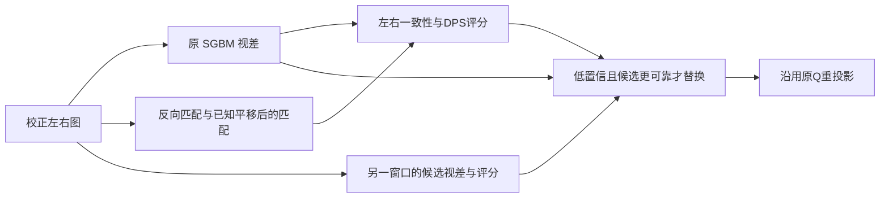

# 置信度与候选重估计实验

本实验以主分支 54ce534 的 OpenCV SGBM 为基线，研究“先判断哪里可能错，再用另一种预测尝试修复”。实验没有训练神经网络，也没有更换相机模型。

## 1. 流程与基线边界

左右校正图 → SGBM 匹配 → 左参考视差 d → Q 重投影 → 深度/三维点。

视差定义为 d=x左-x右。原有效掩码检查搜索区域与数值有效性，不代表匹配正确。

新增逻辑：



## 2. 第一项增加：左右一致性

来源是 Poggi 等 2021 年综述第3.3节所整理的 LRC，不是复现综述内的全部方法。

我们额外把右图作为参考再匹配一次，右视差定义为 d右=x右-x左，通常为负。左像素 x 对应右像素 x-d左，在那里插值读取 d右，计算：

`e_lr = abs(d左(x) + d右(x-d左(x)))`

亚像素位置需要相邻有效点插值；越界或缺预测时置信度未知。

## 3. 第二项增加：DPS位移稳定性

来源是 Lee 等2024论文的式(1)–(5)。原文主要测试端到端深度匹配网络，本实验把同一思想迁移到SGBM，效果需实测。

本实现正k表示右图内容向左移动k列。几何不变时，视差应增加k：`d_k=d_0+k`。注意正号取决于怎样定义移图方向，不能不看约定直接套公式。

取k=-2,-1,1,2四次非零位移，加上原始预测，共N=5；四个绝对残差取平均U。

右图有效ROI和视差搜索范围同时随位移变化。图像填充黑边不参加比较，禁止用np.roll让另一侧内容绕回来。

两种评分都使用 `C=2^(-e)`。DPS用U代替e，对应论文将U=1映射到0.5的归一化。分数是相对一致性，不是正确概率；重复纹理下稳定错配也可能得高分。

## 4. 第三项增加：我们自研的候选重估计

这项不是上述两篇论文的现成方法。我们额外用另一窗口跑SGBM，并计算候选自己的LRC/DPS。两种置信度取较小值，任一种未知则组合分数未知。

只在以下条件同时满足时替换：原像素有效且组合分数<0.5；候选有效且组合分数≥0.5；候选分数至少比原分数高0.15。原高置信像素、未知分数、无效像素保持原样。本轮不补洞也不删点，所以重估计覆盖率与原基线完全相同。

好处是能利用另一个窗口的互补结果；风险是大窗口会跨过物体边缘，把前景和背景混在一起，候选仍可能很自信。原理上没有保证必须改善，因此必须保留替换前、候选、替换后及失败例子。

## 5. 筛选和修复是不同的实验

LRC/DPS筛选只丢掉分数不足的点；它能降低保留点误差，也可能留下更多空洞。重估计尝试改变错误数值，因此必须在相同参考域、覆盖率和共同有效点上比较。

本轮固定4个开发场景：Adirondack、ArtL、Motorcycle、MotorcycleE；其余11场景只评价。窗口3/7/9共3轮开发后冻结为9；之后没有按评价结果调参。Piano/PianoL、Playtable/PlaytableP等变体保持在同一划分。

评价参考域是数据集有限非遮挡GT，误差只统计预测有效点，同时报告覆盖率与失败数；所有四组使用同一参考域。风险曲线在相同保留点数比较置信度排序、固定种子随机排序和只用于诊断的真值理想排序。分数并列时使用固定像素顺序，因此不能过度解释DPS大量高分并列时的曲线。

GT只在预测完成后进入评价和局部误差诊断，不能进入评分或替换函数。诊断区域在评价后挑选，整体结论来自全部11场景。

## 6. 运行与产物

使用项目SVP_env的Python 3.11/OpenCV4.x，在仓库根目录运行：

```sh
python -m unittest discover -s tests -v
python -m src.confidence_experiment --help
python -m src.confidence_experiment --phase develop
python -m src.confidence_experiment --phase evaluate
python -m src.confidence_experiment --phase verify
```

配置为 `config/confidence_experiment.json`，数据路径复用 `config/offline.json`。开发完成后写 `artifacts/confidence_extension/frozen.json`，参数冻结后拒绝重新开发或修改配置；评价结果已存在时拒绝覆盖。要重现同一冻结协议，请在另一个干净检出目录运行，保留既有实验档案。

`artifacts/confidence_extension/`保存每场景数组、原始/候选/最终结果、评分、替换掩码、计时和报告。报告中的计时是单次CPU墙钟，不包含数据加载、评价与存储，不能冒称相机实时帧率。研究总耗时含原始、反向、位移和候选的多次匹配；对比时必须计入这项额外成本。

`notebook/confidence_extension.ipynb`读取冻结结果，汇总指标、风险曲线及局部误差诊断。旧的 `python -m src.cli` 保持不变，研究方法不成为默认入口。

真实设备仍等待队友完成标定/校正；所有新增函数接收既有校正图与几何，不依赖重新标定。未来若系统依据低置信区域改变视角、基线或曝光并重新采集，才进一步形成主动感知；本次多跑几次软件匹配只是被动图像上的一致性分析与重估计。

## 论文来源

- Poggi等，2021，On the confidence of stereo matching in a deep-learning era: a quantitative evaluation。仓库文件前缀 `doc/literature/confidence estimate/2021-01-02_2101.00431`；第4页LRC及后续评价部分。
- Lee等，2024，Modeling Stereo-Confidence Out of the End-to-End Stereo-Matching Network via Disparity Plane Sweep。仓库文件前缀 `doc/literature/confidence estimate/2024-01-22_2401.12001`；第3–4页，特别是式(1)–(5)。

## 7. 冻结评价集结果（2026-11-04）

11/11场景成功，按场景等权汇总；未按评价结果调参。

| 方法 | MAE(px) | RMSE(px) | bad-2 | 非遮挡参考覆盖率 |
|---|---:|---:|---:|---:|
| 原始SGBM | 3.061007 | 8.382753 | 15.5167% | 79.7715% |
| LRC筛选 | 1.734036 | 5.400966 | 11.2342% | 60.3507% |
| DPS筛选 | 2.833510 | 7.679493 | 14.7431% | 78.2671% |
| 组合置信度重估计 | 3.047600 | 8.351048 | 15.5679% | 79.7715% |

重估计MAE仅改善0.4380%，未达5%门槛。覆盖率与基线完全相同，共同有效域比较得到相同结论；6个场景改善、5个变差，bad-2略升。不能宣称这套组合已显著提高整体精度，因此原CLI保持默认，研究扩展为可选实验。

左右一致性有筛选价值，但大量删点换来的低误差不是稠密精度改善。DPS在这次SGBM迁移中的高置信保留小比例甚至比随机排序更差，说明论文在深度网络上的效果不能直接推广到当前SGBM；稳定地错是本实验要展示的反例，而不是需要隐藏的异常。

重估计的评价场景MAE变化（正数表示改善）：

| 场景 | 原始MAE | 重估计MAE | 原始减重估计 |
|---|---:|---:|---:|
| Jadeplant | 6.704803 | 6.645896 | +0.058908 |
| Piano | 2.032685 | 2.032155 | +0.000530 |
| PianoL | 14.022989 | 13.895914 | +0.127074 |
| Pipes | 1.550852 | 1.572445 | -0.021592 |
| Playroom | 1.854760 | 1.853926 | +0.000834 |
| Playtable | 0.988845 | 0.992719 | -0.003874 |
| PlaytableP | 0.899398 | 0.904067 | -0.004670 |
| Recycle | 0.797205 | 0.799755 | -0.002550 |
| Shelves | 2.174887 | 2.187571 | -0.012684 |
| Teddy | 0.735960 | 0.732516 | +0.003443 |
| Vintage | 1.908695 | 1.906635 | +0.002060 |

### 局部替换诊断

- Jadeplant 的(x=421,y=156)：GT=119.3903，原视差1.375，原组合评分约3.33e-24；候选116.8125，候选评分0.8925，被替换后误差由118.0153降为2.5778像素。这次大窗口候选确实补救了原错配。
- Shelves 的(x=213,y=25)：GT=19.3038，原视差19.625，原评分0.000706；候选30.8125，评分0.6380，因此也被替换。可是误差从0.3212增为11.5087像素。原预测虽然正确，反向匹配/位移响应不佳导致评分低；候选的一致性更强也没有保证匹配到正确物体。

这些点由评价后误差变化挑选，不是模型输入。Notebook给出标点、完整数值及局部图；灰色为无效或未知。

### 计算成本与证据

每组参数需要1次原匹配、1次反向匹配和4次位移匹配，两组总计12次SGBM。11个场景单次CPU墙钟均值：原匹配约65.0ms，完整研究预测约766.2ms，约11.8倍；这不是重复运行后的性能统计，也不是相机帧率。

已完成18项无跳过测试、真实SVP_env内核的实验Notebook执行、原CLI基线回归、冻结源文件指纹比对，以及从所有11场景保存数组独立复算指标。反向验证故意制造缺报告、有效NaN和宣称使用GT的报告，核验命令均返回1；恢复原证据后返回0。

原始日志与数组见 `artifacts/confidence_extension/`；`evaluation/metrics.csv` 是逐方法逐场景汇总；`independent_audit.json` 是独立复算结果；`red_green_verification.log` 是反向检查记录。Notebook执行副本和图片在同一忽略目录，源Notebook保持未执行状态。

本轮没有进一步用评价集修规则，也没有单独分离“第二组候选自身”与“置信度选择”的贡献。下一轮研究若要继续，应在新的预先冻结实验中检验更有区分力的评分与候选，而不是把这11场景当成新的调参集。

独立审计还逐像素重算了所有11场景的替换条件，结果与保存掩码一致；在真实Teddy场景随机置换GT，评分、替换掩码及最终视差不变。非遮挡GT上的被替换点中，14213个误差下降、17056个上升、2849个相同。这解释了为什么MAE略降而bad-2略升：少数大错误的修复能抵消更多小错误的增加，不能只看一个均值就称方法可靠。
