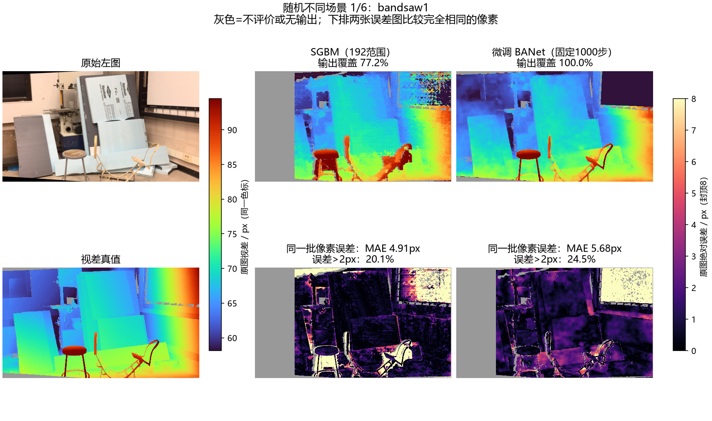
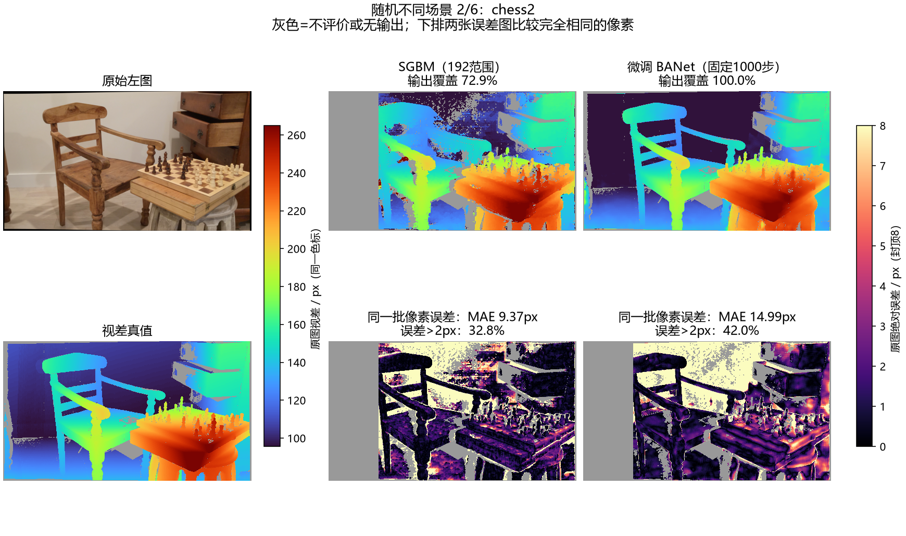
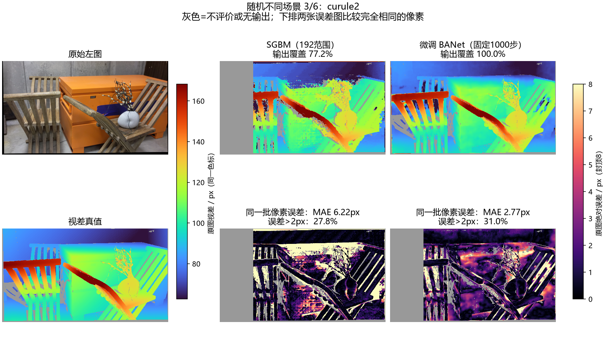
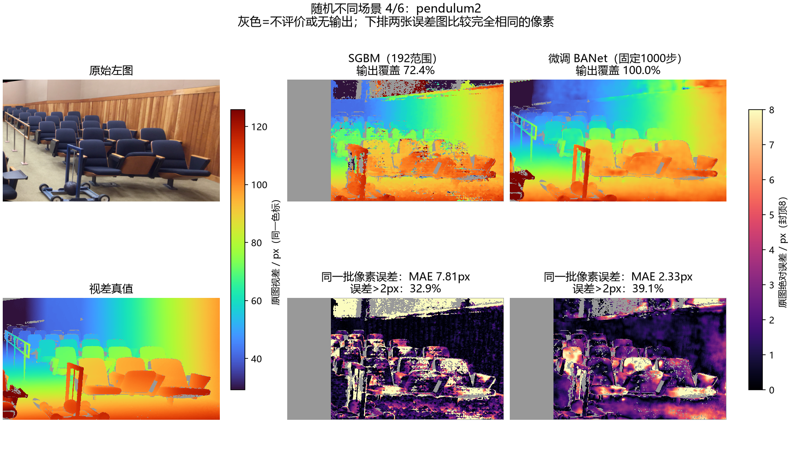
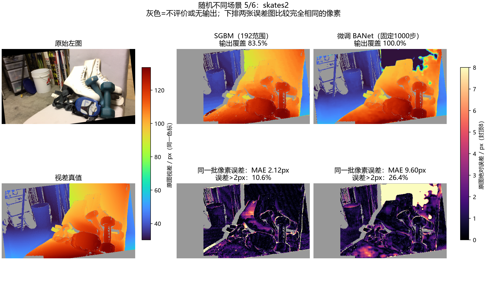
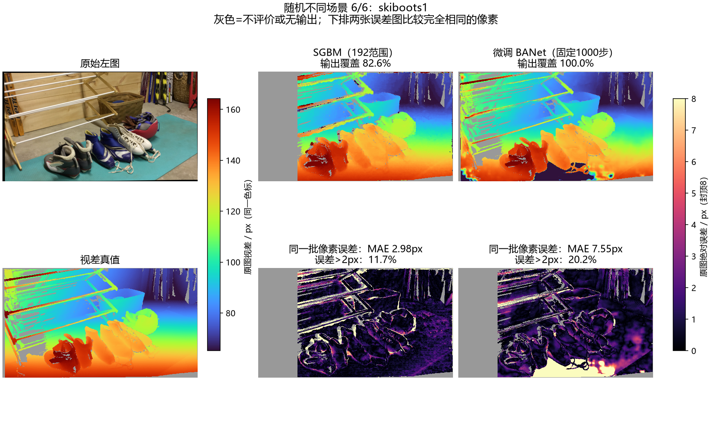

# V0 研究成果审阅入口

日期：2026-11-15；协作者：yingdalei；研究起点：main `54ce534e8cc82dda5b8789611e66785af7740ff0`。本次整理提交到 `codex/V0_yingdalei_4`，供队友 PR 审阅。

## 本次交付

独立研究配置、函数接口、CLI、Notebook 与验证记录覆盖：置信度与低置信重估计、原 SGBM 误差分层、传统 SGM 机制对照、BANet 官方预训练推理、ETH3D 监督微调、扩大比较与训练混入审计、BANet 失误阶段诊断。默认 `src.cli` / `pipeline.py` / `disparity.py`、`config/offline.json` 和基础 `environment.yml` 沿用原版；`model.py` 只追加研究结果类型。

| 研究 | 已执行的工作 | 结果与使用决定 |
|---|---|---|
| 置信度重估计 | 4 开发 / 11 评价场景，开发后冻结候选窗口 | 等权 MAE 改善 0.438%，覆盖率不变，未达到预定 5%；保留原默认 |
| 原 SGBM 诊断 | 15 场景，按互斥区域与误差大小统计 | 错误点约 54.75% 位于低纹理内部，31.83% 位于真值突变带；分类是相关定位，不能单独证明因果 |
| 传统 SGM | 像素 BT、8 路径、固定/自适应 P2；OpenCV HH/筛选及扩范围对照 | HH/筛选有覆盖率代价，自适应 P2 当前预设退步；没有全文复现原论文，也不替换默认 |
| BANet 推理与训练 | 官方固定源码/预训练权重；5060 上 ETH3D 分组 14/4/9 对，1000 步 batch4 FP32 | 峰值 allocated 4833.80 MiB、233.54 秒；验证 MAE 0.4210→0.4725，主协议选择 step0；固定末步只是次级研究候选 |
| 扩大比较 | 48 对 / 26 物理组，包含 24 对新 mobile 图；分别报共同像素误差、全域覆盖和缺失 | 新集泛化失败，不能宣称深度学习稳定优于 SGBM |
| 失误阶段诊断 | 24 对距离统计，四例 hook 重构与归档输出一致 | 约 80% 的 >10px 大错远离真值边界，内部错误在粗视差阶段已出现；没有证明加参数能解决，也未接入替代模型 |

详细协议、度量分母、失败与局限见[计划索引](../exe_plans/README.md)，CLI 复现入口见[README](../../README.md#研究与验证入口)。上述各实验的 MAE 采用不同数据/参考域，不能跨行直接比较。

## 扩大比较的可审阅证据

以下是 **SGBM192 与固定1000步 BANet 在各自数据集共同有效像素上的池化 MAE**，单位为原图像素；不以删点后的低误差代替全域表现。

| 数据 | 图像对数 | SGBM192 | BANet |
|---|---:|---:|---:|
| 新 Middlebury2021 mobile 外部图 | 24 | 6.3942 | 11.6764 |
| ETH3D 既有本地 holdout | 9 | 2.6933 | 0.4122 |
| 旧 Middlebury 开发图 | 15 | 3.1875 | 1.6430 |

[逐场景 CSV](assets/research_v0_yingdalei_4/per_scene.csv) 包含全部 48 对；[精简汇总 JSON](assets/research_v0_yingdalei_4/results.json) 保留共同域、独立覆盖/缺失及物理组统计；[文件 SHA256](assets/research_v0_yingdalei_4/manifest.json) 对应原归档实图的直接复制和仅统一为 LF 换行的 CSV，原 CSV 哈希另列于清单。完整数组、运行环境、数据与权重留在本机忽略目录，不打包进入 Git。

六图使用推理前冻结种子 20261115 抽定的六个不同物理场景；未根据误差挑选。色标和灰色无效区域含义见图内标记。

图中源图和真值来自 [Middlebury 2021 mobile 数据](https://vision.middlebury.edu/stereo/data/scenes2021/)，其余指标还涉及 [Middlebury v3](https://vision.middlebury.edu/stereo/submit3/) 与 [ETH3D](https://www.eth3d.net/datasets)。保留原数据来源和使用条款，模型实现来自 [BANet](https://github.com/gangweix/BANet)。本 PR 未将外部数据集或第三方模型源码作为本项目原创上传。

## 本轮整理的验证与证据边界

- 实际环境：既有 Python 3.11 `SVP_env`，Python3.11.18 / OpenCV4.13.0 / NumPy2.4.6；可选训练依赖 torch2.7.1+cu128、torchvision0.22.1+cu128、timm0.6.13。`python -s -m pip check` 通过，基础 Conda 声明未改为另一个环境。
- `python -s -m unittest discover -s tests -v`：48 项通过、0 失败、0 跳过。另通过模拟缺少 torch 的训练测试发现流程：4 项纯数据测试通过、仅 2 项训练测试跳过；没有将模拟等同于新建干净环境复现。
- `python -s -m src.cli --no-export`：Adirondack MAE 1.3039442220、267000 个评价点，与原基线一致；未进行真实相机实测。
- 从实际 `checkpoint_last.pth` 向独立临时审阅目录导出纯权重，逐张量回读一致；生成的本地模型配置相对路径解析正确，重复写入被拒绝。未覆盖原记录权重或配置。
- 在项目 Python 3.11 中依次执行实验 Notebook 的四个代码单元，冻结候选及成功/失败示例读取正常；使用 Agg 后端核验计算，未进行桌面交互验证。Notebook 文件保持无输出，避免上传运行路径和大图。
- 既有产物重新核验通过：置信度 11 场景；误差诊断 15 场景；SGM 15 场景 / 9 数值组；微调测试数组；1000 步 / 4000 次训练裁剪和采样 RNG 重放；扩大比较 48 对指标、120 个 mobile 归档成员及原 15 场景 SGBM128 逐像素一致。
- 整理时修复自动源码快照缺失、依赖配置冻结不全、基础环境发现测试时强制导入 torch，以及绘图后端导入副作用。新实验自动保存快照，续跑严格核验实时身份；历史审计按执行快照核验，后续工作源码差异单独报告。没有改写旧哈希来冒充重新执行。旧置信度冻结缺基线哈希，只允许读取核验旧数组，重新评价必须新建实验。
- 本轮未重跑训练、完整推理或数值匹配实验；上述精度与速度来自已有实验，重新执行的是测试、默认回归及证据审计。新机器需另外取得数据/权重并使用实际导出哈希；真实中断恢复、干净机器完整复现、替代模型和真实设备测距仍未验证。
- 本次训练集/验证集/本地 holdout 按物理场景分离，训练重放与图像精确/近重复筛查未发现本次训练混入；旧开发图和既有 holdout 的重复分析明确标记。作者预训练缺逐样本完整清单，不能承诺所有上游历史数据完全无泄漏。

下一步由队友审阅研究接口、验证选择和负结果。需要新精度改进时应另立冻结方案与新评价数据；标定和独立真实测距仍按 V0 活动计划推进。本轮未合并 PR，也未清理其他任务的本地文件。
